# ERPlite · Sistema de Administración Empresarial

ERP ligero para una pyme: **RRHH, inventario, compras, ventas con facturación, dashboard, reportes PDF/Excel y auditoría**, con permisos configurables por rol.

| Capa | Tecnología |
|---|---|
| Base de datos | PostgreSQL 15+ (3FN, vistas, triggers, CHECK, EXCLUDE, índices parciales y trigram) |
| Backend | Python 3.12+ · FastAPI · SQLAlchemy 2 · Pydantic v2 · JWT · ReportLab · openpyxl |
| Frontend | React 18 · Vite · TailwindCSS · Recharts |

## Capturas

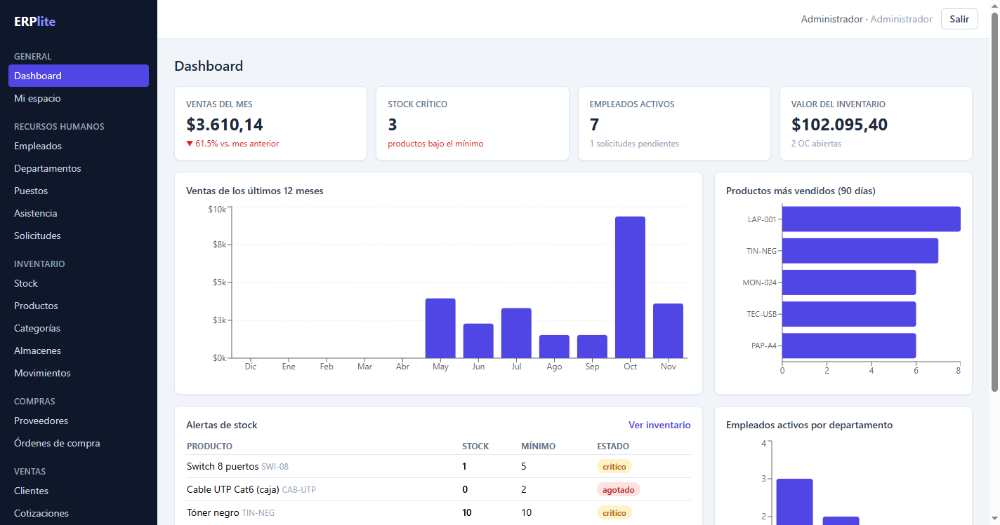

| | |
|---|---|
| 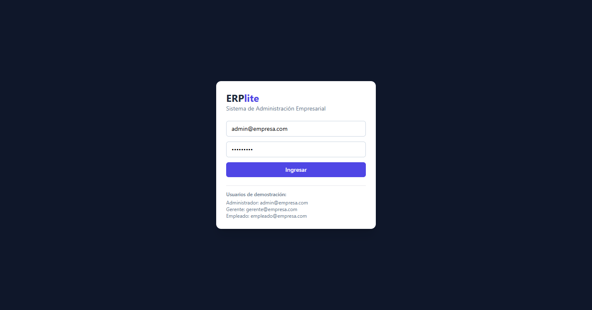 **Login** con usuarios demo | 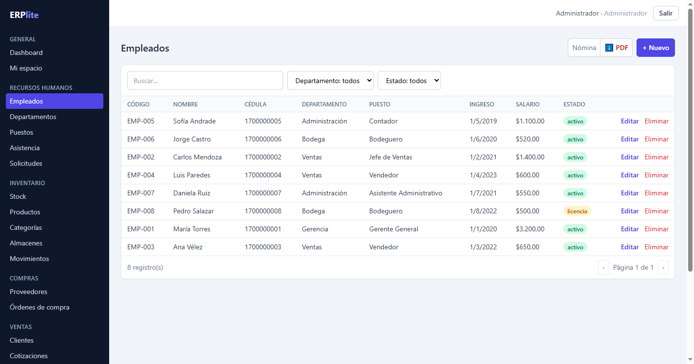 **Empleados** con búsqueda, filtros y paginación |
| 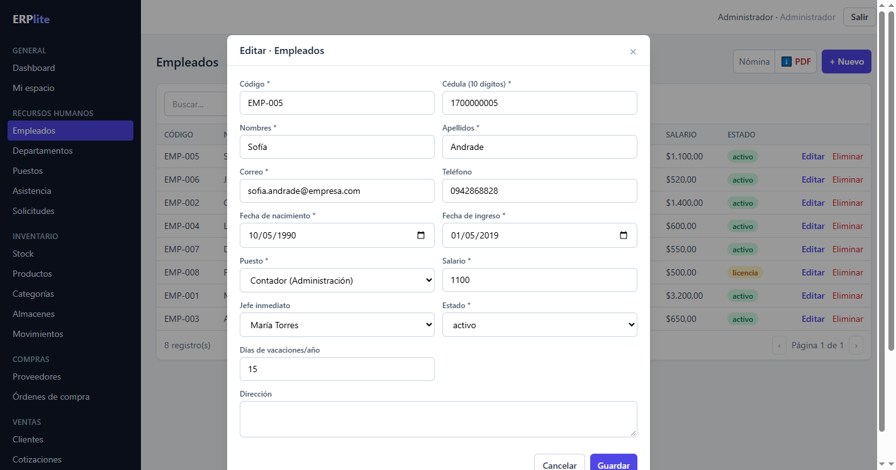 **Formulario** generado por configuración | 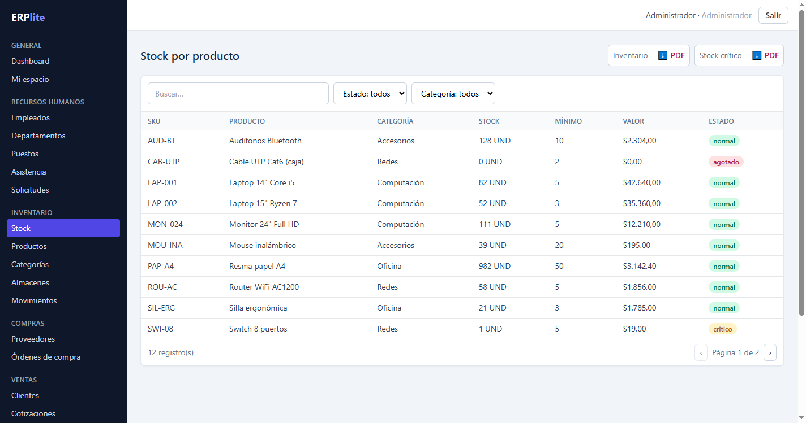 **Stock** con semáforo y reporte PDF |
| 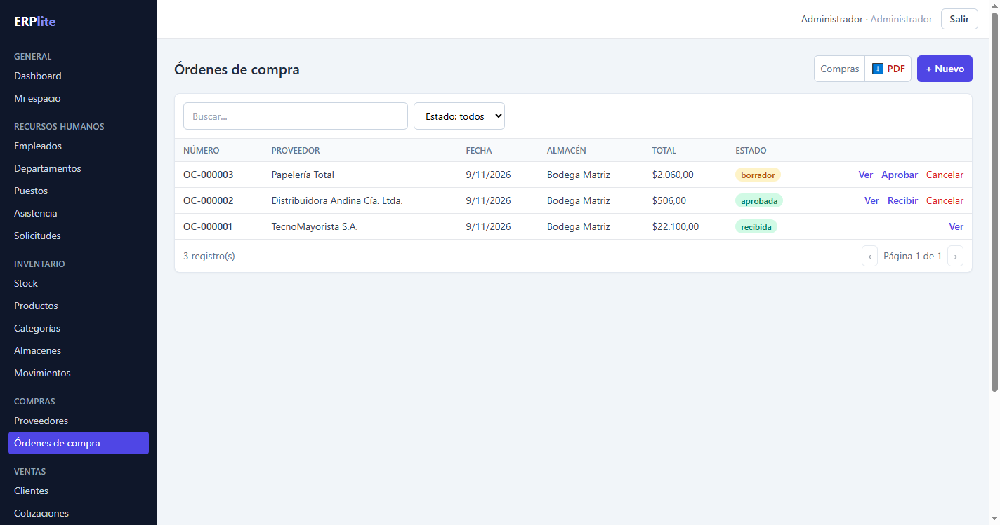 **Órdenes de compra** con flujo de estados | 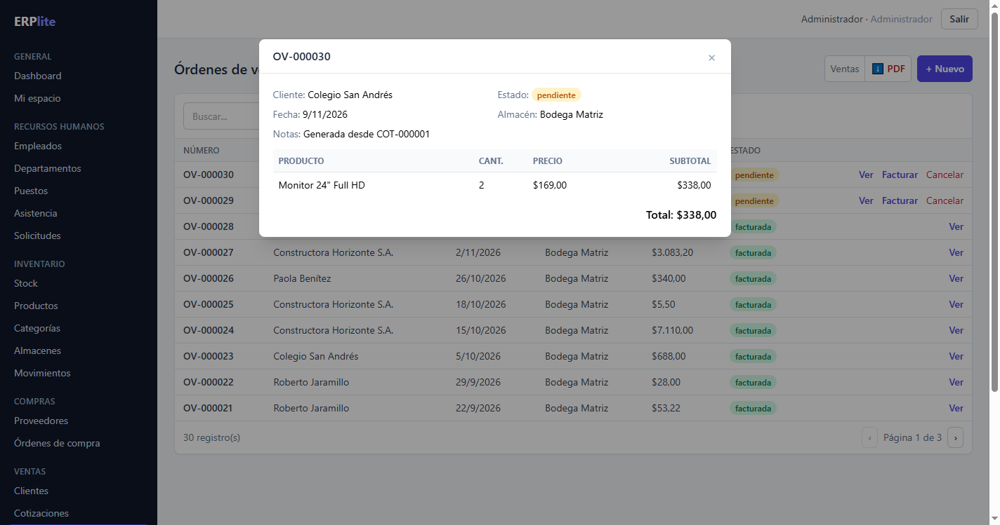 **Orden de venta** lista para facturar |
| 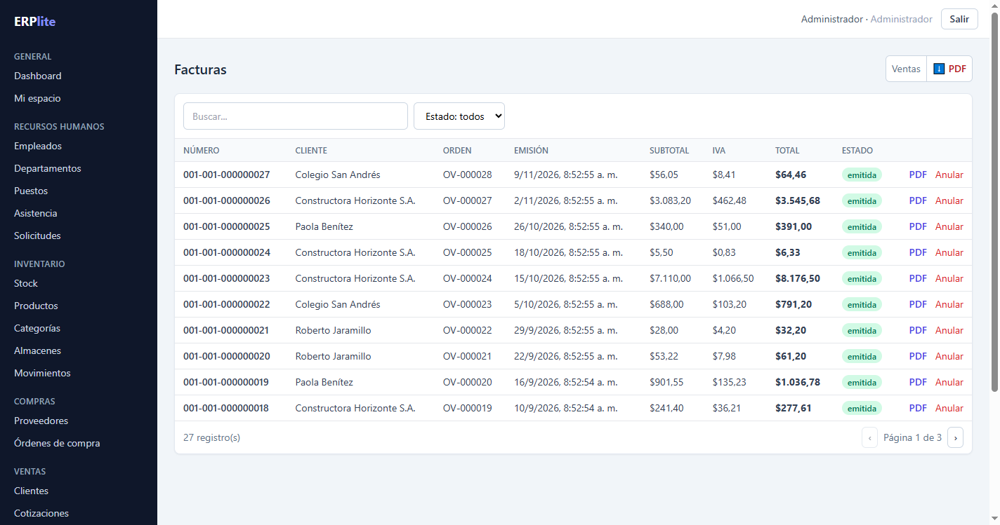 **Facturas** con PDF y anulación | 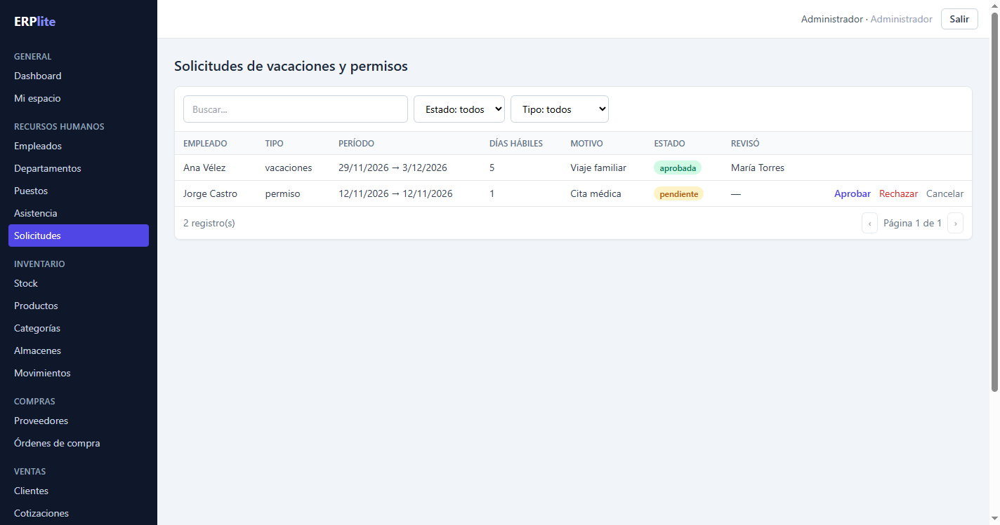 **Solicitudes** con aprobación |
| 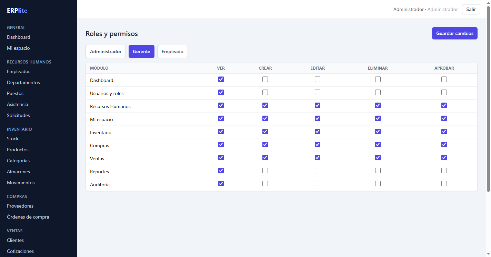 **Permisos** configurables por rol | 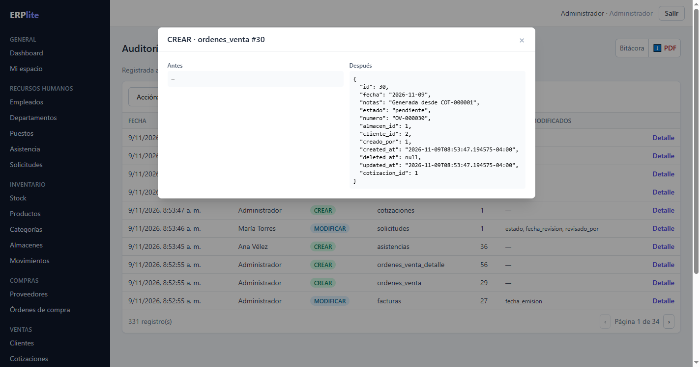 **Auditoría** con el antes y el después |
| 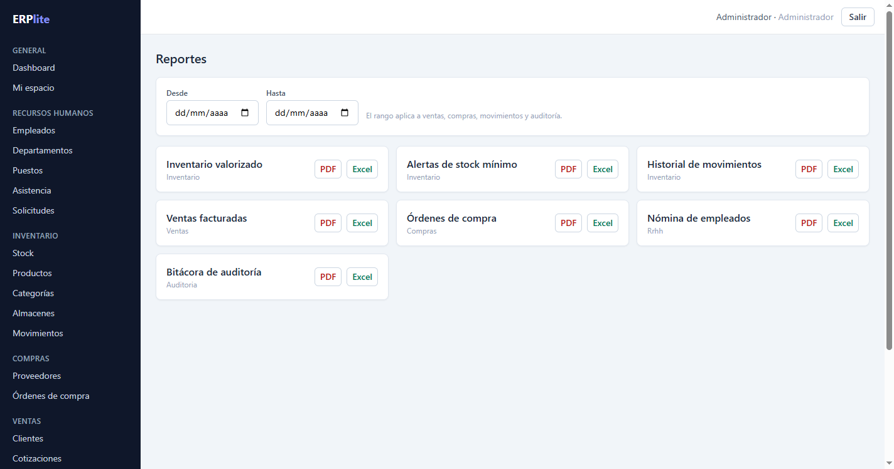 **Reportes** PDF y Excel | 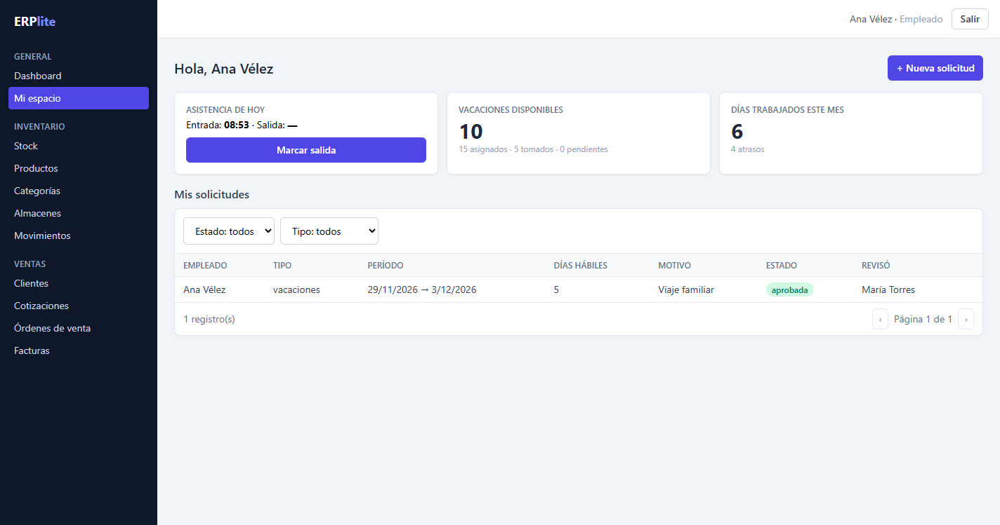 **Autoservicio** del empleado |

  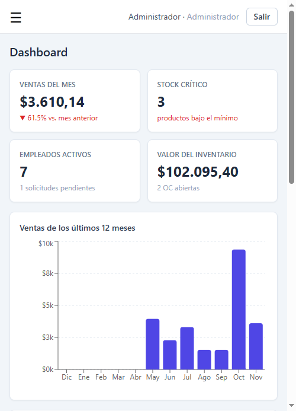
  &nbsp;&nbsp;
  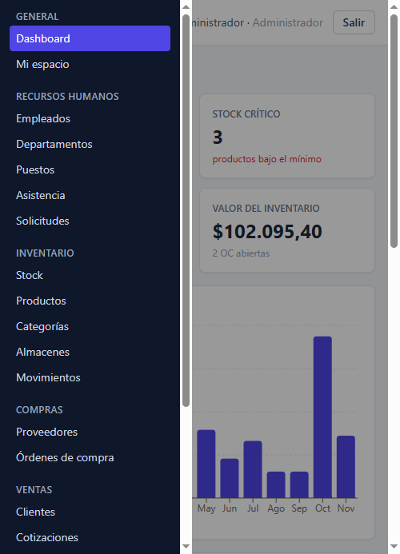

## Funcionalidades

- **Usuarios y roles**: administrador, gerente, empleado. Matriz de permisos *rol × módulo × acción* (ver, crear, editar, eliminar, aprobar) editable desde la interfaz.
- **RRHH**: empleados, departamentos, puestos (con banda salarial), asistencia (el empleado marca entrada y salida), vacaciones y permisos con **flujo de aprobación**.
- **Inventario**: productos, categorías, almacenes, stock por almacén, kardex inmutable, ajustes manuales y alertas de stock mínimo.
- **Compras**: proveedores y órdenes de compra `borrador → aprobada → recibida | cancelada`. Al recibir la orden se registra la entrada al inventario.
- **Ventas**: clientes, cotizaciones (que se convierten en orden), órdenes de venta y **facturación que descuenta inventario en una sola transacción**. Al anular una factura, el stock vuelve al almacén.
- **Dashboard**: ventas del mes con variación respecto al anterior, productos más vendidos, stock crítico y empleados activos.
- **Reportes** en PDF y Excel: inventario, stock crítico, movimientos, ventas, compras, nómina y auditoría.
- **Auditoría**: quién creó, modificó o eliminó cada registro, cuándo y desde qué IP, con el antes y el después en JSON.
- Todas las tablas tienen **paginación, búsqueda y filtros del lado del servidor**, **borrado lógico** y un diseño **responsive**.

