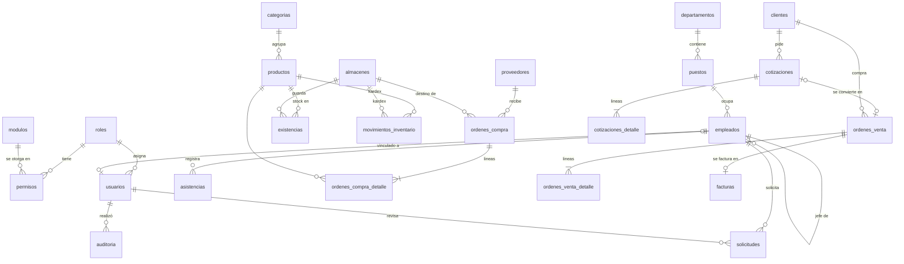

# Diseño de la base de datos

## Modelo entidad-relación

## Normalización (3FN)

- **Sin dependencias transitivas**: el empleado no guarda su departamento. Lo obtiene a través de `puesto → departamento`.
- **Sin totales duplicados**: el total de una orden de compra se calcula desde su detalle en la vista `v_ordenes_compra_resumen`.
- **Dos excepciones deliberadas**, ambas documentadas en el SQL:
  - `precio_unitario` en el detalle de un documento es una *foto* del precio en ese momento. Depende de la línea, no del producto, así que no viola la 3FN.
  - `facturas` guarda subtotal, IVA y total porque es un documento fiscal inmutable: si mañana cambia la tasa de IVA, una factura ya emitida no debe recalcularse.
  - `existencias` es un saldo materializado del kardex que solo modifica un trigger. Existe para poder bloquear la fila (`SELECT … FOR UPDATE`) al vender.

## Restricciones

- **Claves foráneas** en todas las relaciones, con índices en las columnas FK.
- **CHECK**, por ejemplo: cédula de 10 dígitos, RUC de 13, salario mayor que 0, empleado mayor de edad al ingresar, `total = subtotal − descuento + IVA` y que no se otorgue ninguna acción sin "ver".
- **EXCLUDE** (`btree_gist`): un empleado no puede tener dos solicitudes vigentes con fechas que se crucen.
- **Borrado lógico** con `deleted_at`. Las claves naturales usan **índices únicos parciales** (`WHERE deleted_at IS NULL`), así un registro eliminado no impide volver a usar su código.
- Índices **trigram** (`pg_trgm`) para que las búsquedas `ILIKE '%texto%'` usen índice.

## Vistas: por qué son útiles

| Vista | Para qué sirve |
|---|---|
| `v_stock_productos` | Stock total por producto, valor del inventario y estado (normal, crítico, agotado) |
| `v_stock_critico` | Alertas de stock mínimo |
| `v_ventas_mensuales` | Ventas por mes, solo con facturas vigentes |
| `v_lineas_vendidas` | Líneas efectivamente vendidas, para el ranking de productos |
| `v_ordenes_compra_resumen` | Total de cada orden de compra calculado desde su detalle |
| `v_saldo_vacaciones` | Días de vacaciones asignados, tomados y disponibles |

1. **Una sola definición**: el dashboard, la API y los reportes leen la misma vista, así que "stock crítico" significa lo mismo en todas partes.
2. Mantienen el modelo normalizado sin obligar a la aplicación a repetir los JOIN y los agregados.
3. Sirven como capa de seguridad: un rol de reportería puede tener `SELECT` sobre las vistas sin ver las tablas base.

## Triggers: por qué son útiles

| Trigger | Qué hace |
|---|---|
| `fn_auditoria` | Registra cada INSERT, UPDATE o DELETE en `auditoria`: usuario, IP, campos cambiados y el antes y el después en JSON |
| `fn_aplicar_movimiento` | Cada movimiento del kardex actualiza `existencias`. Si una salida dejaría el stock negativo, aborta la transacción |
| `fn_transicion_estado` | Impide saltarse el flujo de un documento, por ejemplo pasar de `borrador` a `recibida` |
| `fn_inmutable` | El kardex y la auditoría no se pueden modificar ni borrar |
| `fn_set_updated_at` | Mantiene `updated_at` actualizado |

Las reglas que protegen la integridad viven **junto a los datos**: si un script, otro sistema o alguien con `psql` modifica las tablas, las reglas se siguen cumpliendo.

Para que la auditoría sepa quién hizo el cambio, el backend ejecuta `set_config('app.usuario_id', …, true)` al iniciar cada transacción. Con `true`, el valor solo dura esa transacción, así que una conexión reutilizada del pool nunca hereda el usuario de otra petición.

## Transacción crítica: facturar ([app/services/ventas.py](../backend/app/services/ventas.py))

1. Bloquea la orden de venta con `FOR UPDATE`, para que dos usuarios no puedan facturar la misma orden.
2. Bloquea las existencias en orden de `producto_id`. Un orden fijo evita deadlocks entre ventas simultáneas.
3. Valida el stock de **todas** las líneas y devuelve juntos todos los faltantes.
4. Inserta la factura con el IVA calculado según si cada producto lo grava.
5. Inserta las salidas del kardex. El trigger descuenta las existencias y vuelve a validar.
6. Cambia la orden a `facturada`. El trigger valida que la transición esté permitida.
7. `COMMIT`. Si algo falla, `ROLLBACK`: no queda factura, ni movimientos, ni stock descontado.
